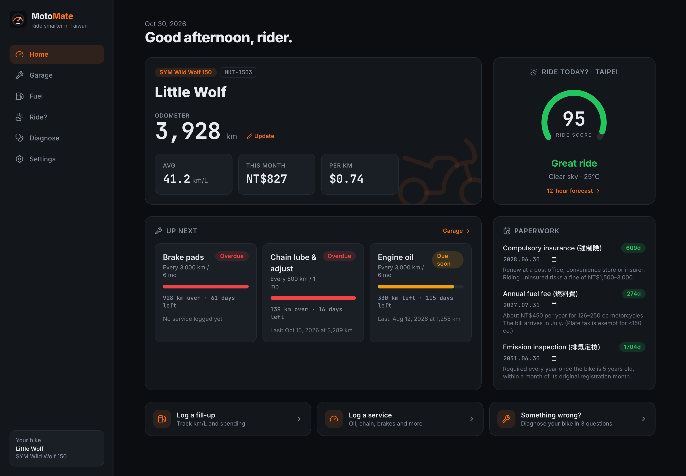
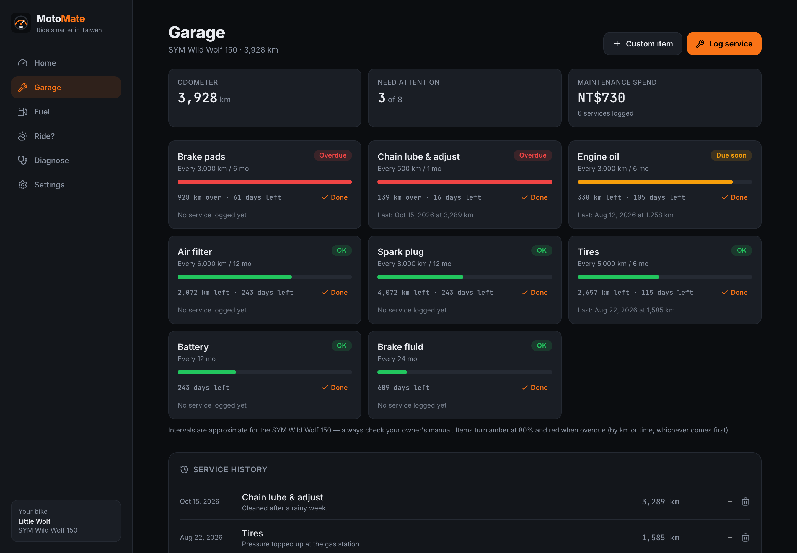
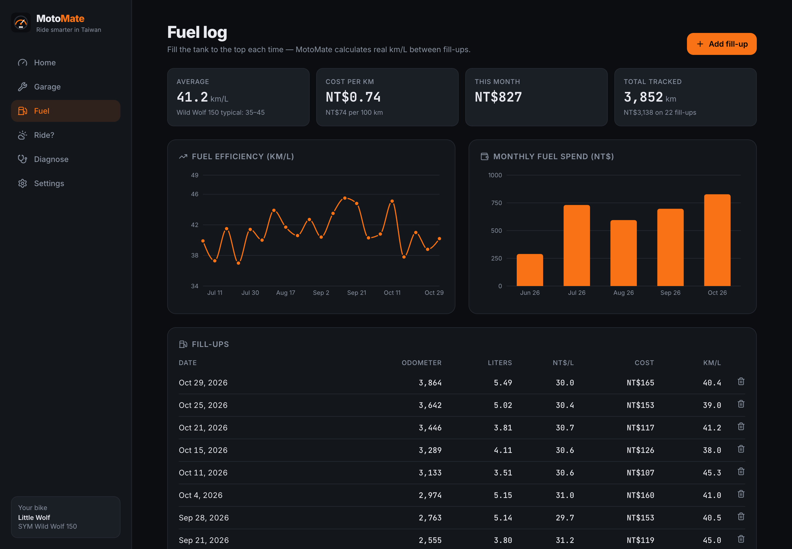
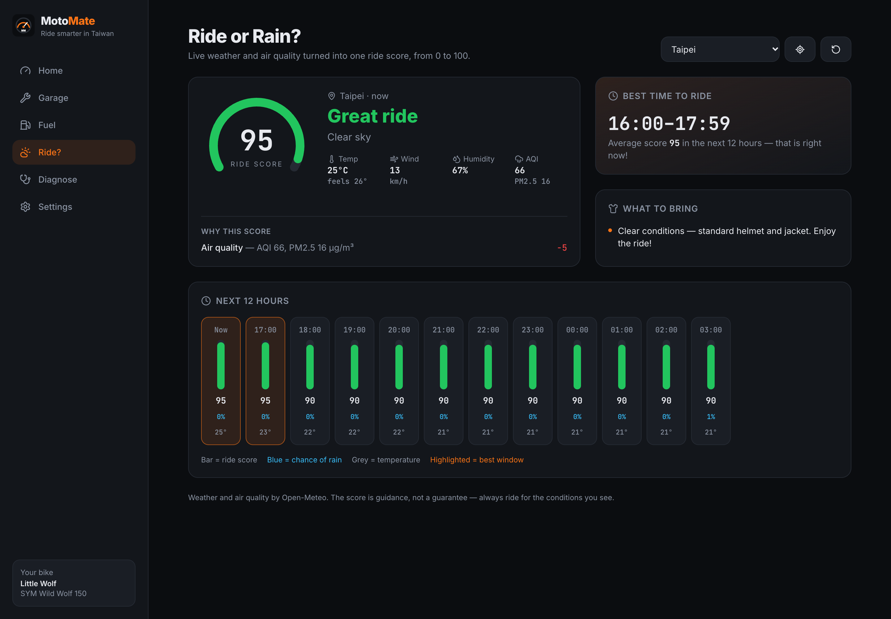
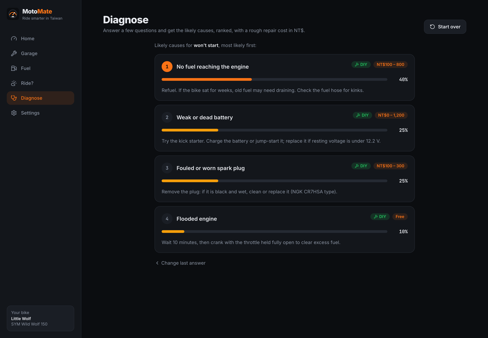

# 🏍️ MotoMate — ride smarter in Taiwan

**MotoMate** is a free web app for motorcycle and scooter riders in Taiwan. It keeps your bike healthy, tracks what you spend on fuel, tells you whether today is a good day to ride, and helps you figure out what's wrong when your bike acts up.

It was built for **Next Byte Hacks V5**, inspired by my new **SYM Wild Wolf 150**.

> **Try it instantly:** open the app with `?demo` at the end of the URL (e.g. `https://your-app.vercel.app/?demo`) to load 4 months of sample riding data.



## Features

| | Feature | What it does |
|---|---|---|
| 🏠 | **Dashboard** | Your bike, odometer, today's ride score, upcoming maintenance and Taiwan paperwork deadlines at a glance. |
| 🔧 | **Garage** | Preset service schedule for the SYM Wild Wolf 150 (oil, chain, brakes, tires, spark plug…). Each item tracks **both km and time** and turns amber/red when due. Log services with cost, add custom items, see full history. |
| ⛽ | **Fuel log** | Log fill-ups and get real **km/L** (full-tank method), cost per km, monthly spend, and charts. |
| 🌦️ | **Ride or Rain?** | Live weather + air quality for 12 Taiwan cities (or your GPS location) turned into a **0–100 ride score**, an explanation of the score, the best 2-hour window to ride, and what gear to bring (raincoat, PM2.5 mask, sunscreen…). |
| 🩺 | **Diagnose** | A rule-based expert system for 8 common problems (won't start, stalling, chain noise, brakes, battery…). Answer 2–3 questions and get ranked causes with confidence, DIY-or-shop advice, rough NT$ cost and safety warnings. |
| 📄 | **Paperwork reminders** | Compulsory insurance (強制險), annual fuel fee (燃料費) and emission inspection (排氣定檢) countdowns. |

Everything is stored privately in your browser (localStorage) — no account, no server, no tracking. Works on phones and can be installed to the home screen.

| Garage | Fuel log |
|---|---|
|  |  |

| Ride or Rain? | Diagnose |
|---|---|
|  |  |

## Tech stack

- **React 19 + TypeScript**, built with **Vite**
- **Tailwind CSS 4** for styling, **lucide-react** icons
- **Recharts** for the fuel charts
- **Open-Meteo** forecast + air-quality APIs (free, no API key)
- **Vitest** unit tests for the ride score, fuel math, service schedule and diagnosis engine
- Deployed on **Vercel**

## Run it locally

You need [Node.js](https://nodejs.org) 20 or newer.

```bash
npm install      # install dependencies
npm run dev      # start the dev server → http://localhost:5173
npm test         # run the unit tests
npm run build    # production build into dist/
```

## Deploy your own (no command line needed)

1. **Create a GitHub repo:** go to [github.com/new](https://github.com/new), name it `motomate`, set it to **Public**, and click *Create repository* (don't add a README).
2. **Push the code** from this folder:
   ```bash
   git remote add origin https://github.com/<your-username>/motomate.git
   git branch -M main
   git push -u origin main
   ```
3. **Deploy on Vercel:** go to [vercel.com/new](https://vercel.com/new), sign in with GitHub, pick the `motomate` repo and click **Deploy**. Vercel detects Vite automatically — no settings to change.
4. Your app is live at `https://motomate-xxxx.vercel.app`. Add `?demo` to show sample data.

## Project structure

```
src/
  lib/            core logic (pure TypeScript, unit-tested)
    schedule.ts   Wild Wolf 150 service schedule + due calculation
    fuel.ts       km/L, cost per km, monthly spend
    rideScore.ts  weather → ride score, best window, gear tips
    weather.ts    Open-Meteo API client + Taiwan cities
    diagnose.ts   rule-based diagnosis engine + symptom data
    reminders.ts  Taiwan paperwork reminders
    demoData.ts   deterministic sample data
    store.tsx     app state (React context + localStorage)
  pages/          Dashboard, Garage, Fuel, Ride, Diagnose, Settings
  components/     shared UI (cards, gauge, progress bars…)
```

## Disclaimer

Service intervals, repair costs and regulations are approximate and for guidance only — always check your owner's manual, a licensed mechanic, and official government sources.

## License

MIT
